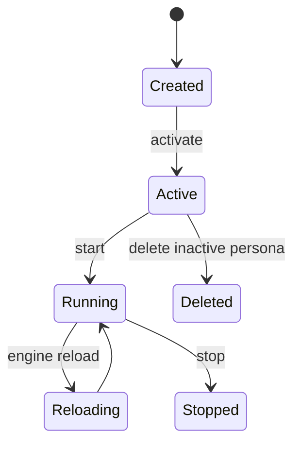

# 人格系统

人格是 Sirius Pulse 的运行单元。每个人格有独立配置、记忆、平台适配器、日志和运行状态。

## 生命周期



## CLI 管理

```bash
python main.py persona list
python main.py persona create <name>
python main.py persona activate <name>
python main.py persona delete <name> --force
```

## WebUI 管理 API

| 方法 | 路径 | 说明 |
|---|---|---|
| `GET` | `/api/personas` | 列出人格。 |
| `POST` | `/api/personas` | 创建人格。 |
| `GET` | `/api/personas/active` | 当前活跃人格。 |
| `POST` | `/api/personas/{name}/activate` | 切换活跃人格。 |
| `DELETE` | `/api/personas/{name}` | 删除人格。 |
| `POST` | `/api/persona/start` | 启动当前人格。 |
| `POST` | `/api/persona/stop` | 停止当前人格。 |
| `GET` | `/api/persona/status` | 查看当前人格运行状态。 |

## 人格数据目录

每个人格的数据都在 `data/personas/{name}/`；Compose 把它挂到容器内 `/app/data/personas/{name}/`，模型与工具看到的路径必须是这个容器路径。

- `persona.json`：名称、人设、语气等基础设定。
- `adapters.json`：平台适配器配置。
- `persona.db`、`memory/`、`memory_units/`：记忆与运行状态。
- `tool_data/`：各 Tool 的配置、队列与产物。
- `assets/`：人格自己的形象参考图（三视图 / 立绘，可以按服装或形态建子目录）。每次对话组装 system prompt 时会自动列出其中的图片路径和视图标注，模型可直接把它们作为 `image_generate` 的参考图，或用 `read_image` 查看细节。宿主机上的其他图片目录（例如 `/root/assets`）不在容器挂载范围内，需要先把要用的图复制进 `assets/`。
